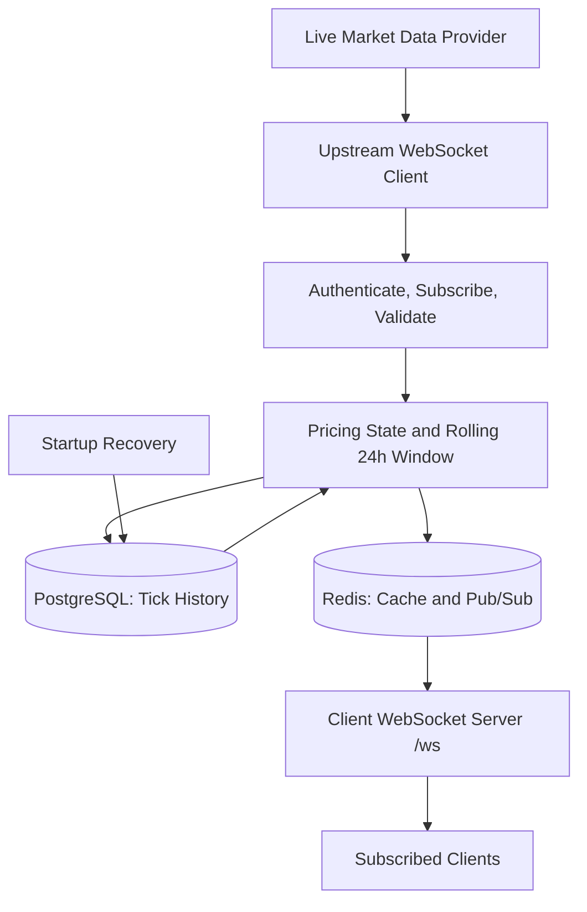

# Real-Time Pricing Engine

A TypeScript market-data service that ingests a live provider feed over WebSockets, maintains rolling 24-hour pricing statistics, persists state in PostgreSQL, and distributes per-symbol updates to subscribed WebSocket clients.

The repository also includes a merchant authentication and KYC demonstration API. The pricing engine is the primary assignment; merchant auth/KYC is documented separately below.

## Features

- Connects to the configured live market-data WebSocket and authenticates with server-side credentials.
- Subscribes to the assignment's configured market symbols.
- Validates incoming prices and timestamps, filters duplicate/stale/future data, and handles reconnect/resubscription.
- Calculates its own rolling 24-hour high, low, and percentage change instead of trusting provider summary fields.
- Persists tick history in PostgreSQL and restores recent state at startup.
- Uses Redis for cached state and Pub/Sub distribution.
- Serves a client WebSocket endpoint at `/ws`, with independent symbol subscriptions and cached snapshots.
- Batches database writes and reports WebSocket frame-size and distribution-latency measurements.
- Includes Docker Compose setup and GitHub Actions validation.

## Architecture



### Main components

| Component | Responsibility |
| --- | --- |
| Market-data ingestion | Connects to the configured provider, authenticates, subscribes, validates and deduplicates ticks, and reconnects when disconnected. |
| Pricing | Maintains per-symbol state and rolling 24-hour statistics using time-aware history and monotonic queues/deques. |
| PostgreSQL / Prisma | Stores market ticks and supports state recovery. |
| Redis | Caches latest state and distributes updates through Pub/Sub. |
| Client WebSocket server | Handles client subscriptions, initial snapshots, live updates, payload limits, and slow-client backpressure. |
| Merchant auth/KYC | Separate API module for merchant registration, login, session revocation, KYC submission, and guarded trading-access demonstration. |

## Technology stack

- Node.js 22, TypeScript
- Express 5 and `ws`
- PostgreSQL 17 and Prisma
- Redis 7 / Pub/Sub
- pnpm
- Docker Compose
- Vitest and GitHub Actions

## Prerequisites

- Docker and Docker Compose
- Git
- For local development: Node.js 22 and pnpm 10

## Quick start

### 1. Clone and configure

```bash
git clone https://github.com/ajay-biswal/real-time-pricing-engine.git
cd real-time-pricing-engine
cp .env.example .env
```

Edit `.env` before starting the service. Set the assigned live-provider credentials and a strong JWT secret. Replace the sample PostgreSQL password consistently in `DATABASE_URL`, `DATABASE_URL_DOCKER`, and `POSTGRES_PASSWORD`.

Required provider settings:

```dotenv
MARKET_WS_URL=wss://v3-prod.livefxhub.com/ws/algo
MARKET_API_KEY=your-assigned-api-key
MARKET_SECRET_KEY=your-assigned-secret
```

Never commit `.env` or real credentials. The application uses the configured live provider; no mock or synthetic market-data feed is included.

### 2. Start with Docker Compose

```bash
docker compose up --build -d
docker compose ps
docker compose logs -f app
```

The default local ports are:

| Service | Host port |
| --- | ---: |
| HTTP API and client WebSocket | 5000 |
| PostgreSQL | 5434 |
| Redis | 6379 |

The PostgreSQL and Redis ports are bound to localhost by the Compose configuration. The application container waits for the database and Redis health checks.

Check the HTTP health endpoint:

```bash
curl -i http://localhost:5000/health
```

A healthy HTTP response confirms that the API is responding; it does **not** prove that the external provider is delivering current prices.

### 3. Run locally

Ensure PostgreSQL and Redis are running and the host-side `DATABASE_URL` points to the PostgreSQL host port configured in `.env`.

```bash
pnpm install --frozen-lockfile
pnpm exec prisma generate
pnpm exec prisma migrate deploy
pnpm dev
```

The local development server uses `PORT` (3000 by default in `.env.example`). Docker Compose overrides this to port 5000.

Useful commands:

```bash
pnpm typecheck
pnpm test
pnpm build
pnpm benchmark:ws -- ALL 120
```

See `package.json` for the authoritative list of scripts.

## Pricing calculations

The engine calculates rolling 24-hour statistics from its own accepted tick history. It does not use provider-supplied `low_24h`, `high_24h`, or `change_24h` values as its own calculations.

The conventional percentage-change formula is:

```text
percentage_change = ((current_price - reference_price) / reference_price) * 100
```

The implementation's reference-price definition must remain consistent; missing reference prices and division by zero must be handled explicitly. Observations outside the rolling 24-hour window must not influence the current high or low.

## Client WebSocket API

Local endpoint:

```text
ws://localhost:5000/ws
```

Subscribe to symbols:

```json
{ "action": "subscribe", "symbols": ["EURUSD", "GBPUSD"] }
```

Unsubscribe:

```json
{ "action": "unsubscribe", "symbols": ["EURUSD"] }
```

The server returns subscription acknowledgements, cached snapshots, live price updates, and errors for invalid requests. Pricing payloads include symbol, buy/sell prices, rolling high/low, percentage change, and timestamps. Numeric prices are serialized as strings to preserve decimal representation.

A client can subscribe to up to 100 symbols. The server enforces outbound payload limits and applies backpressure handling for slow clients. Use `wss://` when deployed behind correctly configured TLS. Redis Pub/Sub is not a durable message queue; clients may need a fresh snapshot after reconnecting.

## Persistence and recovery

PostgreSQL stores market tick history; Redis holds cached state and carries live Pub/Sub updates. On startup, the service restores retained tick history and reconstructs the in-memory rolling state. Database writes are batched to reduce per-tick write overhead, trading some persistence delay for fewer database operations.

Recovery should be validated by persisting real ticks, restarting the application, and comparing the restored per-symbol statistics with expected values. Redis Pub/Sub does not replay messages missed while a consumer is disconnected.

## Benchmarking and observed results

Start the application, then run:

```bash
pnpm benchmark:ws -- ALL 120
```

The benchmark subscribes to the configured symbol set and reports symbol coverage, snapshots and updates received, actual UTF-8 frame sizes, publication-to-client distribution latency, and timestamp-derived tick age.

One observed 120-second run reported:

| Measurement | Observed result |
| --- | ---: |
| Symbols subscribed | 61 |
| Symbols that returned a snapshot or update during the run | 50 / 61 |
| Updates received | 16,977 |
| Initial snapshots received | 50 |
| Frame size p50 | 243 bytes |
| Frame size p95 / p99 | 246 / 246 bytes |
| Maximum observed frame size | 251 bytes |
| Publication-to-client latency p50 | 2 ms |
| Publication-to-client latency p95 | 8 ms |
| Publication-to-client latency p99 | 21 ms |
| Maximum observed publication-to-client latency | 28,675 ms |

These are observations from one run, not a universal performance guarantee. Eleven symbols did not return data during that observation window. The benchmark's distribution-latency sample includes snapshots as well as updates, so the maximum can reflect an old cached snapshot; investigate outliers separately.

**Important distinction:** publication-to-client latency is not the same as provider-event-to-client end-to-end latency. The current measurement does not establish that the assignment's 50 ms end-to-end target is met. Repeat the benchmark after the live feed is stable, verify all required symbols, and measure true provider-event timestamps where the provider supplies trustworthy timestamps. A frame-size result from a limited run should also be reproduced under representative load.

### Metrics worth tracking

- Accepted inbound ticks per second
- Tick receipt to pricing-state update latency
- Redis publication to client receipt latency
- Provider event to client receipt latency, when source timestamps permit
- Actual serialized frame size
- Per-symbol live-data coverage
- Database batch duration and persistence throughput
- State-recovery duration after restart

## Fault tolerance and operational validation

The implementation includes reconnect/resubscription behavior, tick validation and deduplication, rolling-window handling, batched persistence, startup recovery, and downstream client backpressure controls. These features still need validation under representative failure conditions.

Before claiming production readiness, verify:

- Provider authentication, subscription acknowledgements, and ongoing updates for all required symbols.
- Duplicate, out-of-order, stale, invalid, and bursty tick behavior.
- Provider disconnect and reconnect behavior.
- PostgreSQL and Redis interruption/recovery behavior.
- Correct statistics after restart and history replay.
- Slow-client behavior and frame sizes at realistic subscription counts.
- Sustained latency under representative load.

Document measured results and any failures; a successful build or health check alone does not establish live-feed correctness or latency compliance.

## Merchant authentication and KYC module

The repository also includes merchant registration/login, JWT bearer sessions, Redis-backed revocation and rate-limit counters, PostgreSQL/Prisma-backed merchant and KYC records, role checks, and a protected trading-access example.

Key endpoints:

| Method | Endpoint | Purpose |
| --- | --- | --- |
| POST | `/api/auth/register` | Register a merchant |
| POST | `/api/auth/login` | Obtain a bearer token |
| GET | `/api/auth/me` | Get the authenticated merchant |
| POST | `/api/auth/logout` | Revoke the current token |
| POST | `/api/kyc/submissions` | Submit KYC metadata |
| PATCH | `/api/kyc/admin/merchants/:merchantId/kyc` | Development-only manual KYC review |
| GET | `/api/trading/access` | Demonstrate verified-merchant access guard |

Passwords are hashed with bcrypt; JWTs use HS256, issuer/audience validation, expiration, and token IDs. Authenticated requests check revocation and reload merchant state. The manual KYC review route is disabled in production and is only for local Postman testing; it is not a real identity-verification workflow.

See [Merchant authentication and KYC API](docs/merchant-auth-kyc.md) and import [the Postman collection](postman/merchant-kyc-auth.postman_collection.json) for endpoint details and a smoke-test sequence.

## Continuous integration

GitHub Actions runs the repository's configured dependency, type-check, test, and production-build checks. A passing CI run does not verify the external provider, full symbol coverage, live latency, or operational resilience.

## Repository layout

```text
src/
  config/
  modules/
    market-data/
    pricing/
    persistence/
    distribution/
    # merchant/auth/KYC modules
prisma/
scripts/
docs/
postman/
.github/
Dockerfile
docker-compose.yml
.env.example
README.md
```

## Current status

The core ingestion, rolling-pricing, persistence, Redis distribution, client WebSocket, and merchant auth/KYC components are implemented. A recent local benchmark received updates for 50 of 61 subscribed symbols and measured a 251-byte maximum frame in that run. Full symbol coverage, true end-to-end latency compliance, and all fault-tolerance/recovery scenarios remain to be demonstrated with repeatable live-feed validation.


## Frontend dashboard

The React dashboard lives in `frontend/` and connects to the existing client WebSocket at `/ws`. It renders only prices received from the backend; it does not generate mock market data.

### Frontend structure

The UI is split by responsibility so live-data behavior and feature UI can evolve independently:

- `src/App.tsx` — restores the browser-tab session and switches between authentication and the dashboard.
- `src/auth.ts` — typed authentication API calls and merchant/session types.
- `src/marketCatalog.ts` — instrument catalog, category metadata, and shared price/time formatters.
- `src/useMarketData.ts` — WebSocket lifecycle, subscriptions, reconnect handling, latest snapshots, and session-local chart history.
- `src/features/account/AccountAccessPanel.tsx` — merchant status, KYC metadata submission, and backend trading-access check.
- `src/features/markets/MarketDirectory.tsx` — search, category filters, and the market table.
- `src/features/markets/MarketChartPanel.tsx` — selected instrument chart and quote details.
- `src/features/markets/TopMoversPanel.tsx` — ranks the largest observed 24-hour market moves.
- `src/MarketDashboard.tsx` — composes the dashboard layout and connects feature components to shared market state.


### Run the dashboard locally

Start the backend first, then in a second terminal:

```bash
cd frontend
cp .env.example .env
pnpm install
pnpm dev
```

By default, Vite proxies `/ws`, `/health`, and `/api` to `http://localhost:5000` (the Docker Compose backend port). If you run the backend directly on its default port, set `VITE_BACKEND_ORIGIN=http://localhost:3000` in `frontend/.env`.

For a frontend hosted separately from the backend, set `VITE_WS_URL` to the browser-accessible WebSocket URL, for example `wss://your-api-host.example/ws`. Do not put market-provider credentials in frontend environment variables.

### Frontend checks

```bash
pnpm typecheck
pnpm build
```

The price chart is session-local: it plots incoming live updates observed by the browser and does not pretend to be a historical chart loaded from an endpoint that the backend does not currently expose.

### Frontend authentication and authorization

The React dashboard uses the existing merchant API:

- Register and sign in with `POST /api/auth/register` and `POST /api/auth/login`.
- Validate restored browser-tab sessions with `GET /api/auth/me`; access tokens are kept in `sessionStorage` and sent as bearer tokens for protected API requests.
- Sign out through `POST /api/auth/logout`, which revokes the current token through Redis.
- Submit KYC metadata through `POST /api/kyc/submissions`.
- Check trading permission through `GET /api/trading/access`. The API requires an active account, the `MERCHANT` role, and `kycStatus: VERIFIED`; frontend state is not the security boundary.
- Market quotes remain read-only and the client WebSocket endpoint remains unauthenticated for the pricing-engine demonstration. Do not connect actual trading actions to the UI without adding authenticated server-side authorization for each trading operation.

The KYC UI is a demonstration metadata form, not a real identity verification provider. The development-only KYC review key must never be placed in the frontend.
